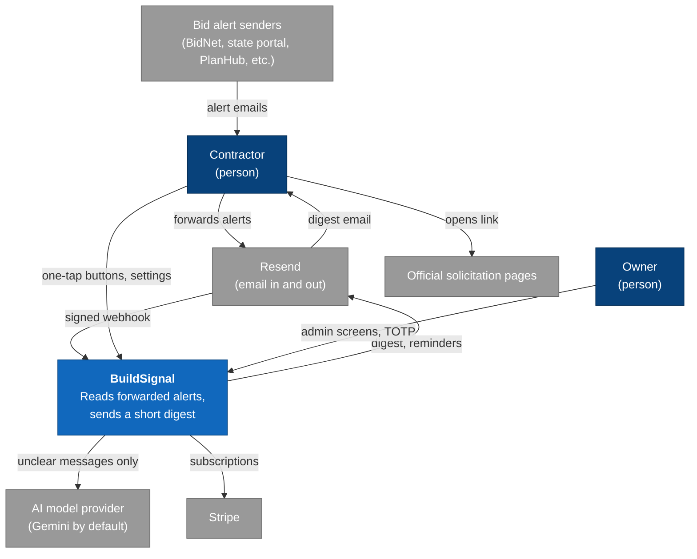
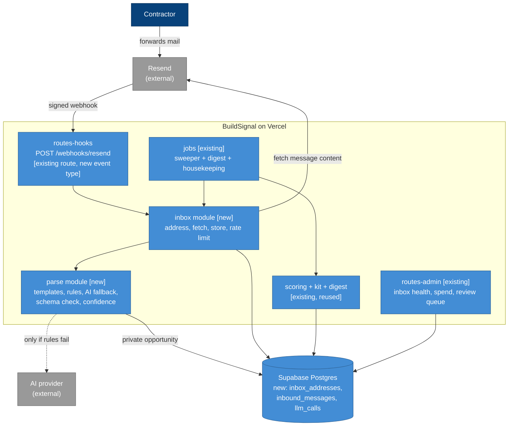
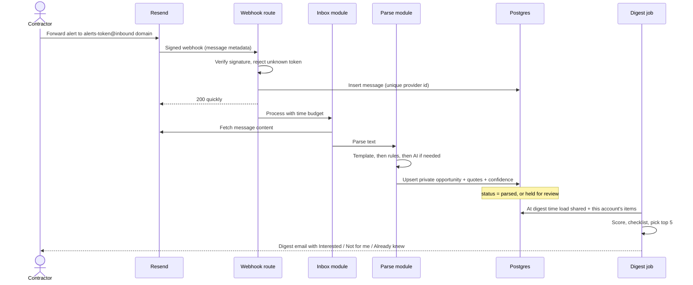
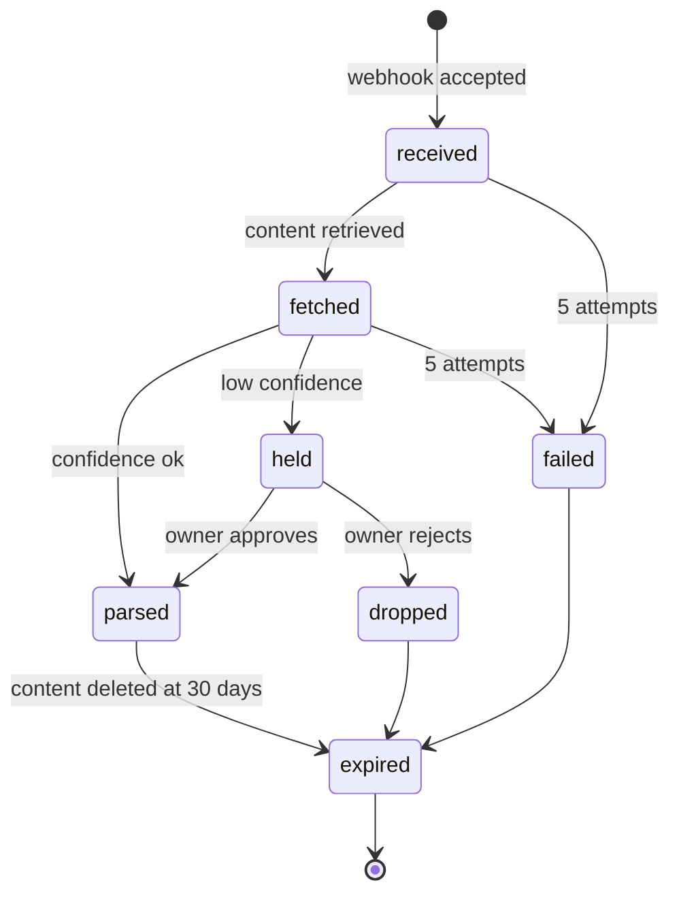

# Architecture: Forwarded-alert digest (the "inbox" feature)

> Status: **Draft, nothing here is built or tested yet** · Last updated: 2026-10-13 · Scope: a new feature on the deployed BuildSignal app (see `docs/ARCHITECTURE.md` for the existing system)

Source documents: there is no SRS or use-case document. Drivers are stated in prose and come from the research report `reports/Contractor software gap analysis.md` (2026-10-13), the existing app, and the owner's answers on 2026-10-13 (open sign-up with a 14-day trial; rules first with an AI fallback). No requirement IDs are used because none exist.

## 1. Introduction and goals

**What it is.** A contractor forwards the bid alerts they already receive (BidNet, Arizona Procurement Portal, PlanHub or BuildingConnected invitations, any other sender) to a personal address we give them. We read each message, drop duplicates, apply the existing eligibility and fit rules, and send one digest of at most five items. The research found that the most repeated independent complaint about the incumbents is not missing data but an unusable inbox: irrelevant invites, duplicates, wrong pre-bid dates, and no outcome feedback.

**Why forwarding.** The research could not retrieve the terms or robots.txt for any Maricopa-area portal, and the project rule is "unknown terms = blocked". So we never scrape or log in anywhere. The customer's own forwarded mail is the lowest-risk route, though it is not a confirmed-permitted one (portal terms on forwarding are unread; see Risks).

**Top quality goals, in priority order**
1. **Trustworthy extraction.** Every date, requirement or dollar amount shown comes from a quoted passage in the email or is labeled "not found". Driver: project rule against invented requirements; Handoff reviewers' documented complaint about invented prices.
2. **Bounded cost.** Variable cost at or under $4 per active customer per month, with a hard global AI spend cap, because the owner chose open sign-up and so anyone can send mail to an address. Driver: owner's cost target plus the abuse exposure of open sign-up.
3. **Hands-off operation.** About 30 minutes a week of owner time: self-retrying, self-reporting, no manual parsing queue unless confidence is low. Driver: owner constraint.

Also binding: **tenant isolation** (one customer's forwarded mail never appears for another) and **minimal retention** of mail content.

## 2. Constraints

| Constraint | Source | Effect |
|---|---|---|
| No scraping or logins on portals | Research report; owner rule | Forwarded mail only |
| No single charge above $50; monthly plans | Owner brief | Unchanged: Starter $29, Pro $49 |
| Fixed cost at or under $80 a month | Owner brief | Reuse Vercel, Supabase, Resend; no new paid vendor |
| One non-developer owner | Owner | Managed services only; no servers or queues to run |
| Product never submits bids; shows ROC number on drafts | Owner brief | Unchanged |
| Never claim a feature works unless tested code backs it | Owner rule | Launch gating by feature flag until tests pass |
| Existing stack: Node 22 ESM, zero runtime dependencies, Vercel function, Supabase Postgres, Resend, Stripe | Deployed app | New code follows it; the AI client is a thin `fetch` wrapper, no SDK |
| Lock-in tolerance | Inferred, owner to correct | Accept Vercel, Supabase and Resend coupling; keep parsing and scoring free of provider code |

## 3. Context and scope

**Outside the boundary:** the portals and networks themselves, the customer's own mail account, the official solicitation documents (we link and never host them).

## 4. Solution strategy

- **Extend the existing app as a module, not a new service** (ADR-101). One deployable, same database.
- **Receive mail through Resend** on a dedicated inbound subdomain, one unguessable address per account (ADR-102).
- **Keep forwarded items private to the account** by scoping them with an owner column on the existing opportunities table, so scoring, pipeline, response kit and calendar files are reused (ADR-103).
- **Parse in three tiers: sender templates, generic rules, then a validated AI fallback** with source quotes, confidence gating and a spend cap (ADR-104).
- **Acknowledge the webhook fast, then process with a retry sweep** instead of adding a queue (ADR-105).
- **Deduplicate per account and track changes as versions** (ADR-106).
- **Treat all mail content as untrusted data** (ADR-107).

## 5. Building block view

| Block | Responsibility | Depends on |
|---|---|---|
| `inbox` | Issue and revoke the per-account address; verify the webhook; store messages idempotently; enforce size, rate and daily limits; run the message state machine | store, Resend |
| `parse` | Turn message text into a normalized opportunity with per-field source quotes and a confidence value | `taxonomy`, AI client |
| AI client | One function, provider-swappable (Gemini default), JSON-schema output validated before use, token and cost logging, spend-cap check | `fetch` only |
| scoring, kit, digest, pipeline | Unchanged logic; the loader now returns shared and account-owned opportunities | store |
| admin | Inbox health, spend against cap, low-confidence review queue, kill switch | store |

## 6. Runtime view

**Scenario A: a forwarded alert becomes a digest item.**

**Scenario B: failure paths.**
- Webhook arrives twice: the unique provider message id makes the second insert a no-op.
- Content fetch or AI call times out: message stays `received`, attempts increase, the sweeper retries with backoff, and after 5 attempts it is marked `failed` and counted on the admin screen.
- AI returns invalid JSON or low confidence: the item is not shown with guessed fields. It goes to the review queue, or appears in the digest as "Unparsed alert: open your email" with only the subject and sender.
- Spend cap reached: AI fallback switches off, rules continue, admin is alerted by email.

**Inbound message states**

## 7. Deployment view

No new infrastructure. Environments are unchanged: local, Vercel preview, Vercel production, with Stripe and Resend in test mode outside production. New requirements are an inbound subdomain with its DNS record at the domain registrar (owner task) and one new webhook endpoint registered in Resend. Using a separate subdomain keeps inbound mail routing apart from the sending domain's records.

## 8. Cross-cutting concepts

**Security and privacy**
- **Addresses:** `alerts-<random 128-bit token>@<inbound domain>`; only the token hash is stored; revocable and re-issuable from settings.
- **Webhook:** Svix signature verification (the code already exists for Resend webhooks), 5-minute timestamp tolerance, unknown token returns 200 with no processing so senders learn nothing.
- **Tenant isolation:** every opportunity row from forwarded mail carries `owner_account_id`. A single loader function is the only code path that reads opportunities for scoring, and a test proves account A never receives account B's items.
- **Retention:** message text is deleted 30 days after receipt; extracted fields remain until the account is deleted. Attachments are never stored. One-click deletion removes addresses, messages and owned opportunities (tested).
- **Third parties:** message text goes to the AI provider only for fallback cases. The Privacy page must say so and say no customer data is used for training; this is an attorney-review item.
- **Open sign-up exposure:** per-account daily message cap (default 40), per-message size cap, global AI spend cap, all editable in admin settings.

**Data.** Postgres stays the single store. New tables: `inbox_addresses`, `inbound_messages` (id, account, provider message id unique, received_at, sender domain, subject, capped text, status, parse method, attempts, error, expires_at), `llm_calls` (message, provider, model, tokens in and out, cost in dollars, latency, confidence). New columns on `opportunities`: `owner_account_id`, `provenance` (field to quoted passage), `also_seen_via`. Migrations are SQL files applied through the Supabase tooling already used.

**Resilience.** Idempotent inserts, bounded retries with backoff, a sweeper in the existing cron entry points, and explicit degraded modes (AI off, rules only). Cron continuation on live Vercel is already an unproven item in the existing risk list; this feature inherits it.

**Observability.** Structured JSON log lines using the existing `log()` format. New events: `inbox.received`, `inbox.rejected` (reason), `inbox.fetched`, `parse.template_hit`, `parse.rules_hit`, `parse.ai_call` (tokens, cost, latency), `parse.held`, `parse.failed`, `inbox.sweep`. Diagnosis guide: a customer says "my alert never showed up" → find `inbox.received` by account; if absent, check the Resend webhook log and the address token; if present, read `state_to` and `error_code` on the same message id; if `held`, it is in the review queue; if `parsed`, check the digest's `matches` row and the score threshold.

**Testing.** Strategy: many unit tests, integration tests with the in-memory store, and a thin end-to-end path.
- **Runner:** keep `node --test` (existing, zero dependencies). **Coverage:** none enforced; criterion coverage only. This is the owner's call to change.
- **Evaluation set:** at least 60 forwarded-email fixtures across senders and trades with labeled fields and planted prompt-injection messages. Targets from the brief: key-field extraction at or above 90%, zero successful injections. Results are reported as measured.
- **Critical end-to-end flows:** forward, parse, digest, "Interested", response kit; address deletion removes everything; duplicate webhook delivery creates one item; tenant isolation.
- **The AI is stubbed in CI** with recorded responses; no live calls in the suite.

**Performance.** Not a driver. The webhook path does one fetch, rules, and at most one AI call within a time budget; everything else is the existing daily batch.

## 9. Architecture decisions

### ADR-101: Add an inbox module to the existing app, not a separate service

**Status:** Proposed · **Date:** 2026-10-13
**Requirements addressed:** hands-off operation; one-person ownership; fixed cost at or under $80 a month.
**Context.** The feature needs a webhook, a parser, and a few tables. A single non-developer owner operates the system.
**Decision.** Build it as modules inside the current Vercel app and Supabase database.
**Options considered.**
- **Module in the existing app (chosen).** No new deploy target or cost; reuses auth, store, jobs, scoring. Con: the parser's time budget shares the function limits.
- **Separate worker service.** Isolates long parses. Con: another thing to run and pay for, for no current load driver.
**Consequences.** One deploy, one set of logs. If parsing outgrows function time limits, extract `parse` behind its existing function boundary.

### ADR-102: Receive forwarded mail with Resend on a dedicated inbound subdomain

**Status:** Accepted, with residual verification items (see Consequences) · **Date:** 2026-10-13
**Requirements addressed:** no scraping; no new paid vendor; per-customer addresses.
**Context.** We need to receive mail programmatically. Facts verified from Resend's docs on 2026-10-13 (details and links in `docs/inbox-detailed-design.md` section 1):
- Mail arrives at a verified custom domain after an MX record is added (Resend's MX must have the lowest priority value on that name), or at a Resend-managed `<id>.resend.app` address with no setup. A subdomain is recommended when the root domain already has mail.
- The webhook event is `email.received`. It carries metadata only (email id, from, to, `received_for`, subject, message id, attachment list), not the body.
- The body is fetched with `GET /emails/receiving/{id}`; the response includes `text`, `html`, `headers`, attachments with sizes, and an `authentication` object (SPF, DKIM, DMARC).
- Received mail counts against the plan quota (Free 100 a day and 3,000 a month; Pro $20 a month with 50,000 a month). The API limit is 10 requests per second per team.
**Decision.** Use Resend receiving on an inbound subdomain (`in.<domain>`) with one tokenized address per account, reusing the existing `/webhooks/resend` endpoint and signing secret (this replaces the earlier `POST /webhooks/inbound` idea).
**Options considered.**
- **Resend (chosen).** Already our email vendor and webhook verifier; one dashboard.
- **Postmark or Cloudflare Email Routing/Workers.** Both receive mail. Cons: a second vendor, and limits not verified here.
- **Gmail or Outlook OAuth read access.** No forwarding step for the customer. Cons: restricted-scope review by the providers and a far heavier privacy burden.
- **Paste-only or upload-only.** No inbound infrastructure. Con: contractors will not paste daily; kept as a fallback form.
**Consequences.** Because the webhook carries metadata only, the Vercel function payload limit of 4.5 MB (Vercel docs, 2026-10-13) should not apply to it. Still unverified, because the pages read do not say: maximum message and attachment size, how long Resend keeps received mail, the webhook retry schedule, whether `email.received` and the existing bounce events can share one endpoint, and whether inbound carries any separate price (none was found). These are checked with a real test message in task T13 of the build plan. Owner task: choose the domain and add the MX record (or use the `resend.app` address for the first live test). Revisit if Resend's limits or price break the cost ceiling.

### ADR-103: Scope forwarded items to the account instead of sharing them

**Status:** Proposed · **Date:** 2026-10-13
**Requirements addressed:** tenant isolation; unread portal terms; reuse of scoring, kit and pipeline.
**Context.** The existing "extract once, match many" design shares opportunities across customers. Forwarded content may be a private invitation or may come from a portal whose reuse terms are unread. Showing one customer's PlanHub invitation to another customer would redistribute it.
**Decision.** Add `owner_account_id` to `opportunities`. Rows with a null owner stay shared (Mesa, Phoenix, SAM). Forwarded rows are visible only to their owner. One loader function applies the filter; no other code reads the table for scoring.
**Options considered.**
- **Owner column on the existing table (chosen).** Everything downstream works unchanged.
- **A separate `inbox_items` table.** Cleaner isolation but duplicates scoring, matches, kit and pipeline code.
- **Share across accounts with dedupe.** Cheaper AI cost ("extract once"). Rejected on redistribution and privacy grounds until terms are read.
**Consequences.** AI extraction cost is paid per customer instead of once, which is why ADR-104 caps it. Isolation depends on one filter, so it gets a dedicated test and is reviewed at every change to the loader.

### ADR-104: Three-tier parsing with a validated AI fallback and a spend cap

**Status:** Proposed · **Date:** 2026-10-13
**Requirements addressed:** trustworthy extraction; cost at or under $4 per customer per month; owner chose rules first with an AI fallback.
**Context.** Alert emails differ by sender and often carry only a title, agency and due date. Rules are cheap and predictable but miss unknown formats. A model reads anything but can invent fields and can be steered by hostile text.
**Decision.**
1. **Sender templates** for the few high-volume senders, added as data plus one function per sender.
2. **Generic rules:** dates near words like "due", "closing", "bid opening"; solicitation numbers; known agency names; links on official domains.
3. **AI fallback** only when tiers 1 and 2 cannot find a title and a deadline. The model returns JSON validated against a schema. Every field must include a quote copied from the message, and the quote is checked to exist in the text; a field with no matching quote is dropped and labeled "not found". Low overall confidence routes to the review queue.
The AI client logs tokens, cost and latency per call, stops at a monthly spend cap held in admin settings (default set at build time from measured cost, not guessed), and the provider is swappable, with Gemini as the default per the project brief.
**Options considered.**
- **Rules plus fallback (chosen).** Best cost and accuracy trade; matches the owner's answer.
- **Rules only.** No AI cost or key. Rejected by the owner because unknown formats would be missed.
- **AI for everything.** Simplest code, highest and least predictable cost. Rejected on the cost goal.
**Consequences.** A quote-verification step makes invented values detectable but not impossible when the model quotes real text and misreads it; the evaluation set measures this. Pricing of the chosen model must be checked when the key is created. The owner must create a new API key and rotate the previously leaked one.

### ADR-105: Acknowledge fast, process inline with a retry sweeper, no queue

**Status:** Proposed · **Date:** 2026-10-13
**Requirements addressed:** hands-off operation; idempotent jobs; no new vendor.
**Context.** Webhook senders expect a quick response and retry on failure. The platform has no long-running workers.
**Decision.** Insert the message, return 200, then process within a time budget in the same invocation. A sweeper in the existing cron entry points retries anything still `received` or `fetched`, with an attempt counter and backoff.
**Options considered.**
- **Inline plus sweeper (chosen).** No queue to run; the database is the source of truth.
- **A hosted queue or workflow product.** Better guarantees. Con: another vendor and cost with no load that needs it.
- **Process only in the daily cron.** Simplest. Con: new mail would not be reflected in the same morning's digest if it arrives late, and failures surface a day later.
**Consequences.** If the platform stops a function after the response is sent, a message can sit until the next sweep. This is acceptable for a morning digest and is visible in admin. The existing risk that Vercel cron behavior is unproven applies here too and gets verified on the first real day.

### ADR-106: Deduplicate per account and record changes as versions

**Status:** Proposed · **Date:** 2026-10-13
**Requirements addressed:** the most repeated incumbent complaint is duplicates and wrong dates.
**Decision.** Fingerprint each item from normalized agency, solicitation number (or title) and deadline. A match within the same account merges into the existing item and appends the sender to `also_seen_via`. A changed deadline or addendum notice bumps the version using the existing `opportunity_versions` table and triggers the existing change alert for items marked Interested.
**Consequences.** Titles that differ between senders may fail to merge; the merge rule is tuned on the evaluation set. A false merge is worse than a missed one, so uncertain cases stay separate.

### ADR-107: Treat all mail content as untrusted data

**Status:** Proposed · **Date:** 2026-10-13
**Requirements addressed:** zero successful prompt injections (project brief); open sign-up exposure.
**Decision.** Message text is passed to the model only as quoted data inside a fixed instruction, the model has no tools and no network, output must match the schema or is discarded, links are never fetched, HTML is stripped to text before any storage or display, and every displayed field is escaped. The evaluation set includes planted injections, and a failing injection test blocks release.
**Consequences.** Some legitimate messages with odd formatting land in the review queue. Accepted.

## 10. Quality requirements

| Scenario | Target | How verified |
|---|---|---|
| Same forwarded message delivered twice | One item | Unit test on idempotency |
| Customer A's forwarded alert | Never in customer B's digest or pipeline | Isolation test |
| Evaluation set of at least 60 fixtures | Key-field extraction at or above 90%; zero successful injections | Eval run, results reported as measured |
| AI spend reaches the cap | AI fallback stops, rules continue, owner emailed | Integration test with a stub |
| Account deletion | Addresses, messages, owned opportunities removed | Integration test |
| Message older than 30 days | Content deleted | Housekeeping test |
| Variable cost per active customer | At or under $4 a month | Logged cost per customer in admin; verified in the pilot period, not assumed |

## 11. Risks and technical debt

| # | Risk | Mitigation | Residual |
|---|---|---|---|
| 1 | **Portal terms may forbid forwarding or reuse of their alert emails.** BidNet and PlanHub terms on forwarding were not read. | Owner reads both before launch; items always link to the official source; nothing is shared across accounts (ADR-103) | Unknown until read; a prohibition would end the feature |
| 2 | **Resend receiving details are unverified** (event name, payload, size and plan limits). | Verify first in detailed design; fall back to the paste form | Could force a vendor change |
| 3 | **Open sign-up before any retention evidence.** The research recommended a pilot; the owner chose open sign-up. | Feature flag keeps sign-up closed until the end-to-end test passes; funnel and retention events stay in place so the pilot questions are still answerable | Weak demand will show up as paid churn, not as a pre-launch signal |
| 4 | **AI cost or abuse** from open sign-up. | Per-account daily cap, size cap, global spend cap, kill switch | Cap level is a guess until measured |
| 5 | **Forged mail to a known address** injects junk or hostile text. | Unguessable token, rate limits, ADR-107 handling | A leaked address can be abused until the customer revokes it |
| 6 | **Alert emails often lack scope text,** so eligibility checks are mostly yellow "not stated". | Say so plainly in the checklist; later option to paste the solicitation text | The "can you bid" value is limited on thin alerts |
| 7 | **No evidence that contractors will pay for a cleaner inbox** at $29 to $49. | Measure trial-to-paid and 30-day retention; no accredited data exists for this claim | The central business risk, not a technical one |
| 8 | **Privacy and attorney review:** third-party content, AI subprocessor disclosure. | Privacy and Terms drafts updated; flagged for attorney review | Needs a professional |
| 9 | **Cron continuation unproven** on live Vercel (inherited). | Sweeper is idempotent; manual run from admin | Verify on first real day |

## 12. Open items before detailed design

1. ~~Verify Resend receiving~~ Done for event name, payload, fetch API, quota counting and DNS rules (2026-10-13). Still open: maximum message and attachment size, retention, webhook retry schedule, shared endpoint with bounce events, inbound price. Checked live in build task T13.
2. Owner picks the domain and inbound subdomain (owner task; needed before any live test).
3. Owner reads PlanHub and BidNet terms on forwarding.
4. Choose the AI model and record its current price; owner creates a new key in Vercel and rotates the leaked one.
5. Collect at least 60 real forwarded alert emails (from the owner's own inbox or willing contractors) for the evaluation set; no synthetic-only evaluation.
